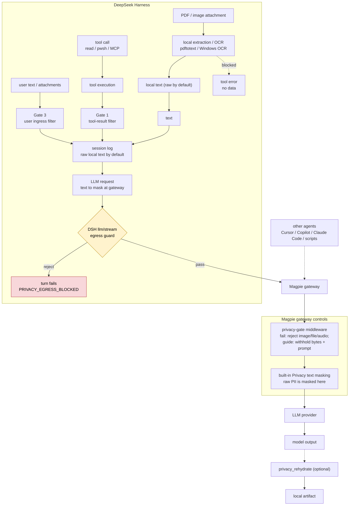

# ShyPie — privacy-first workflow for DeepSeek Harness + Magpie

> Keep PII on your machine: images and PDFs are converted to text **locally**, the local transcript
> stays readable by default, and Magpie masks the text **before it leaves the machine**. Anything that
> cannot be masked or filtered is **blocked**, not sent.

This repository is a reference implementation of a two-plugin combo for
[DeepSeek Harness](https://github.com/deepseek-ai) (DSH) and [Magpie](https://usemagpie.ai):

| Component | npm package | Role |
|---|---|---|
| [`plugins/dsh-privacy-gate`](plugins/dsh-privacy-gate) | `@shypie_privacy/dsh-privacy-gate` | **ShyPie Filter** DSH host bundle: extracts attached images/PDFs locally, keeps tool/document text local by default, guards binary reads, and enforces a fail-closed `llm/stream` egress guard |
| [Magpie middleware (merged in-tree)](https://github.com/magpie-community/plugins/tree/main/packages/privacy-gate) | `@magpie-community/middleware-privacy-gate` | Magpie gateway middleware: rejects or withholds content Magpie cannot mask (images, files, encoded blobs) for non-local models; `binaryPolicy: guide` withholds bytes and asks the model to choose a local extraction tool |
| [`packages/pii-core`](packages/pii-core) | `@shypie_privacy/pii-core` | Zero-dependency detector + keyed-placeholder library shared by both plugins |
| [`packages/local-extract`](packages/local-extract) | `@shypie_privacy/local-extract` | Local-only PDF / Office / scan → text CLI with fail-closed blocking |

`pii-core` and `local-extract` are published on npm at `0.1.0`. The DSH bundle **source** is `0.3.0`
(filter mode, image/PDF extraction, composer switch); npm `0.2.0` is the last published release and
does not include those features. The Magpie middleware was **merged** into
[magpie-community/plugins](https://github.com/magpie-community/plugins/tree/main/packages/privacy-gate)
at `28108dd` (PR #685) as `@magpie-community/middleware-privacy-gate`; its npm package is not
published yet. The legacy `@shypie_privacy/magpie-privacy-gate` package is retired. The DSH catalog
entry [PR #12308](https://github.com/awesome-dsh-plugin/awesome-dsh-plugin/pull/12308) is merged.
Known open issue: [guide-mode MIME metadata validation #795](https://github.com/magpie-community/plugins/issues/795).
[docs/publish.md](docs/publish.md) has the exact state.

It is a **privacy-first workflow**, not a guarantee: what it protects, and what it cannot, is
documented precisely in [docs/design.md](docs/design.md) and summarised below.

## Why two plugins

1. **DSH's outbound request is immutable.** It is a deep-frozen fold of the session log
   (`dsh-agent-loop`, `markAgentLoopRequest`), so a plugin cannot rewrite it on the way out. ShyPie
   Filter therefore does the local part it can do — extract attachments, block bytes it cannot mask,
   and enforce the provider allowlist — while Magpie masks text at the gateway.
2. **Magpie's masking is text-only.** Its own documentation says *"Images and file data are sent as
   they are. Text inside a screenshot is not masked."* A gateway can never mask a PDF page or a
   screenshot, so the gateway must **reject or withhold** what it cannot mask. With
   `binaryPolicy: guide`, it replaces the bytes with metadata and a local-tool prompt; with the
default `fail`, it returns 403.

ShyPie Filter covers what enters the DSH session log; Magpie covers text masking and every other agent
behind the gateway (Cursor, Copilot, Claude Code, scripts). The default `textPolicy: filter` keeps
raw local text; `textPolicy: mask` restores local placeholder masking.

## Architecture



## What it protects

- **Tool and document ingress.** Tool-result text and locally extracted attachment text are kept in
  the local transcript by default. PDFs, Office files, attached images and scans are converted with a
  local extractor/OCR first; unmaskable BLOB/media is blocked. Error-result `meta` is not rewritten and
  remains a documented local residual.
- **Local conversion only.** Text layers use `pdftotext`; scans use `pdftoppm` plus a local OCR
  adapter (on Windows, the built-in `Windows.Media.Ocr` engine — no install, no network). If no
  local engine exists the call is **blocked** (`NO_LOCAL_OCR`), never sent to a cloud converter.
- **Attachments are converted, not forwarded.** An attached image or PDF is read through the
  harness's attachment store, converted locally, and replaced by text *before* the message is logged —
  the step is rejected when the bytes cannot be read (no extractor, failed verification, empty result,
  `imageParts: 'block'` or `fileParts: 'block'`).
- **Un-maskable payloads are rejected or withheld**: base64/hex/`data:`-encoded documents
  (contiguous, line-wrapped or dump-formatted), image/file/audio parts to non-local providers,
  unknown binaries, encrypted PDFs. In `textPolicy: filter` the DSH egress guard allows plaintext
  PII only through the default `magpie*` provider; Magpie must have Privacy masking enabled. For
  other agents, `binaryPolicy: guide` replaces the binary part with type/size metadata and a prompt
  to use a local extraction tool, without forwarding the bytes.
- **Round-trip without exposing values.** `privacy_rehydrate` resolves placeholders inside the tool
  and returns only `{path, replaced, kinds}`; the model can fill a form without seeing the value.

## What it does not do

- **Free-text names** are outside deterministic detection (use the word list or a *local* classifier).
- **Transformed values** (reversed, re-encoded) are not detected; zero-width and soft-hyphen tricks are.
- **Detector false negatives** are possible; the design is layered (rules → local gateway model →
  fail-closed blocks) but not complete. Read [docs/design.md §12](docs/design.md#12-known-limitations).
- **Local at-rest residues** are named, not hidden: filter mode deliberately keeps raw tool/attachment
  text in the local DSH transcript; DSH also records the raw submitted prompt before any plugin seam,
  and Magpie's masking journal keeps values for 30 days.
- **History predating installation** is replayed unchanged — start new sessions after installing.
- The plugins are **not installed by this repository**; installation changes profile-wide state and
  is documented step by step.

## Requirements

- Windows 10/11 (the OCR and path policy are Windows-first; the core libraries are portable).
- DeepSeek Harness with a configurable plugin profile, and Magpie running its local gateway.
- `pdftotext` / `pdftoppm` / `pdfinfo` on `PATH` for PDF text and scan rendering (poppler).
- Node.js 22+ for the test suite and CLI (the bundled DSH runtime works).
- Optional: `tesseract` (an adapter exists but is untested here).

## Quick start

The DSH bundle is on npm at `0.2.0`; the source checkout is `0.3.0` and contains the filter mode,
image/PDF attachment extraction, and the composer switch. The Magpie middleware is merged in-tree at
`magpie-community/plugins` but is not on npm yet; install it from a checkout until it publishes.
The legacy `@shypie_privacy/magpie-privacy-gate` package is retired.

1. Install the Magpie middleware from the community checkout:
   `git clone https://github.com/magpie-community/plugins`, then
   `magpie plugin add <clone>/packages/privacy-gate` (replace `<clone>` with the clone path). After the
   community npm publish: `magpie plugin add @magpie-community/middleware-privacy-gate`.
2. Install the DSH bundle. For the current source features use the checkout:
   `dsh plugin --profile <name> add "$repo/plugins/dsh-privacy-gate"`; the published npm `0.2.0`
   predates filter mode and PDF attachment extraction.
3. In Magpie, enable masking under **Settings → Privacy** (text half of the combo).
4. Start a **new** DSH session and run the checks in [docs/install.md](docs/install.md#verify).

Both plugins are reversible; no profile file is edited by hand. The install names are
`@magpie-community/middleware-privacy-gate` and `@shypie_privacy/dsh-privacy-gate`;
[docs/publish.md](docs/publish.md) covers the release state and the two marketplace listings.

## Verify

```bash
node tests/run-all.mjs
```

Measured on the reference machine (Windows 11, Node 24, no network):

| Suite | Result |
|---|---|
| `pii-core` | 61 tests, 60 pass (1 platform skip); 50,125-char doc with 2,133 hits redacts in 11.5 ms; 300k-digit run 40 ms |
| `local-extract` | 49/49; text PDF, Office, local OCR, and all documented block reasons |
| `dsh-privacy-gate` | 154/154; activation check registers 3 listeners, 1 guard, 5 tools; attached-image OCR and PDF/file extraction are covered; end-to-end image OCR against real `winrt-ocr` takes about 2.5 s |
| `packages/privacy-gate` (in-tree) | 62/62 with `bun test`; `bun scripts/check.mjs` validates the registry merged at `28108dd` |
| `e2e` | 11/11 — synthetic invoice → local text → placeholders → gateway → mock vendor, with zero plaintext on the wire |

The end-to-end suite uses only synthetic fixtures generated at test time. No real document, invoice,
identity paper or personal record is present in this repository.

## Repository layout

```
docs/
  design.md               design, threat model, gates, fail-closed matrix, limitations
  install.md              installation and verification guide
  interface-contract.md   frozen API / CLI / tool interfaces
  publish.md              npm publish order + Magpie and DSH marketplace listings
  research/               evidence: DSH seams (path:line), Magpie hook docs (URL + quote),
                          detector catalogue, measured engine matrix, background, security review
packages/
  pii-core/               detectors, keyed placeholders, encrypted vault
  local-extract/          local-only PDF / Office / OCR to text
plugins/
  dsh-privacy-gate/       DeepSeek Harness bundle
  magpie-privacy-gate/    legacy Magpie mirror (canonical: magpie-community/plugins/packages/privacy-gate)
marketplace/              submission files; Magpie PR #685 merged, DSH catalog PR #12308 merged
assets/brand/shypie/      selected icon package (SVG, PNG, favicon, platform exports)
config/                   example Magpie middleware options
tests/                    end-to-end tests and the one-command runner
LICENSE                   MIT
```

## Documentation

- [Project status](project_status.md) — the initial goal, goal → evidence alignment, and open items
- [Design](docs/design.md) — the full design and threat model
- [Install](docs/install.md) — installation, configuration, verification
- [Interface contract](docs/interface-contract.md) — the stable interfaces both plugins implement
- [Publish](docs/publish.md) — npm release order and the Magpie / DSH marketplace listings
- [Research](docs/research/) — evidence notes, measurements and the [security review](docs/research/security-review.md)
- Component READMEs: [pii-core](packages/pii-core/README.md), [local-extract](packages/local-extract/README.md),
  [DSH gate](plugins/dsh-privacy-gate/README.md), [Magpie gate](https://github.com/magpie-community/plugins/tree/main/packages/privacy-gate/README.md)

## Status

Reference implementation, tested on one Windows machine. **Published:** `pii-core` and
`local-extract` at `0.1.0`; DSH bundle npm `0.2.0`. **Source-only:** DSH `0.3.0` (filter mode,
image/PDF extraction, composer switch) and Magpie middleware `0.1.0` merged in-tree at
`28108dd`. The Magpie npm package is not published yet; the DSH catalog
[PR #12308](https://github.com/awesome-dsh-plugin/awesome-dsh-plugin/pull/12308) is merged, and the
Magpie registry entry is merged. The legacy `@shypie_privacy/magpie-privacy-gate` npm package is
retired. Known open issue: [guide-mode MIME validation #795](https://github.com/magpie-community/plugins/issues/795).
Tag `v0.2.0` and its GitHub release are published. The **live wiring** was exercised manually on
2026-11-03: DSH 0.2.1-rc.5 headless with the bundle installed from npm, two-turn DeepSeek and
Copilot `gpt-6.1-sol` sessions through a live Magpie gateway, and a temporary model-allowlist
block that the gate rejected. The `llm/stream` guard and its stable `PRIVACY_EGRESS_BLOCKED` code
were re-verified on 2026-11-05. On 2026-11-06 the merged guide mode was live-tested: an image was
withheld, the model was asked to process it locally, and no image bytes reached the provider.
OpenAI Responses `encrypted_content` and Anthropic thinking `signature` were replayed through
Copilot-routed models and accepted (HTTP 200). It is not part of the automated suite; remaining
verification limits are listed in [docs/design.md §11](docs/design.md#11-verification).

Security issues: see [SECURITY.md](SECURITY.md).
