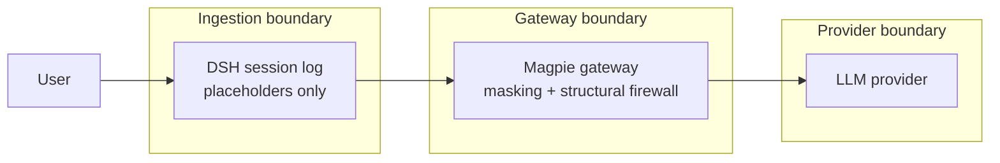
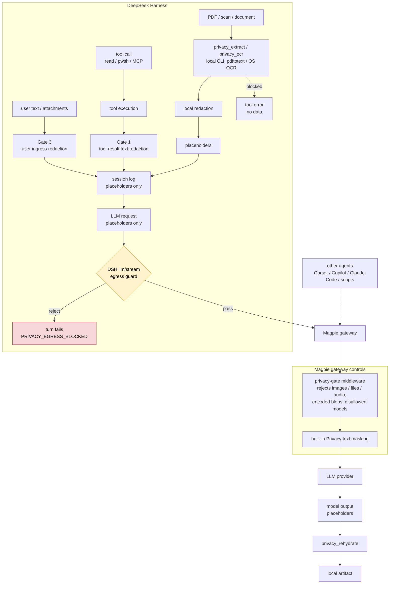

# A privacy-first workflow for DeepSeek Harness + Magpie

**Status:** design + reference implementation (`packages/`, `plugins/`, `tests/`); every suite in
`tests/run-all.mjs` passes on the reference machine — see §11 for what is and is not verified.
**Scope:** keep PII on the machine; mask it before it can reach an LLM provider; convert PDFs and
scans to text locally; block the transfer when local conversion is impossible.
**Origin:** an originating DeepSeek Harness session in which document scans and raw tool output
reached the model in clear text while the gateway's text masking was on. The redacted account is
[`research/background.md`](research/background.md); this document turns that finding into a concrete
two-plugin design and a runnable reference implementation.

---

## 1. Executive summary

The workflow is a **combo of two plugins plus one shared core**:

| Component | Runs in | Owns |
|---|---|---|
| `@shypie_privacy/pii-core` | anywhere (plain JS) | deterministic PII detection, keyed placeholders, restore, encrypted vault |
| `@shypie_privacy/local-extract` | local machine | PDF → text, scan → OCR → text, Office → text; blocks when no local engine exists |
| `@shypie_privacy/dsh-privacy-gate` | DeepSeek Harness (cordis host plugin) | **ingestion** redaction, local extraction tools, `read_image`/binary guards, rehydrate-into-artifact |
| `@magpie-community/middleware-privacy-gate` (in-tree; legacy `@shypie_privacy/magpie-privacy-gate` no longer referenced) | Magpie gateway (moejs middleware) | **egress** firewall for what Magpie cannot mask: image/file/audio parts, blob smuggling, model allowlist |

The split is forced by one hard fact and covers two different gaps:

1. **DSH's outbound request is immutable.** `deepFreeze` + `markAgentLoopRequest`
   (`dsh-agent-loop/lib/index.js:1261-1276`) make the LLM request a pure fold of the session log, so
   there is no "last hop" where a plugin can rewrite it the way Magpie does for its other agents.
   Masking therefore has to happen **before ingestion**: at the tool boundary, before the data is
   appended and replayed forever. That is the DSH gate.
2. **Magpie's masking is text-only.** Its own documentation says *"Images and file data are sent as
   they are. Text inside a screenshot is not masked."* So a PDF page, a screenshot, or an attachment
   passes a masking gateway untouched. Magpie's gateway middleware is the only process that sees the
   final request body just before it goes to a vendor, and it can **reject**. That is the Magpie gate.

Together they give three properties the workflow targets:

- **Recognised PII is masked before it can leave.** Deterministic detectors run in-process; no
  detector calls a network. The qualifier is real: a value the detectors do not recognise (a
  free-text name, reversed text, an uncatalogued format) is not masked — see §12.
- **The session log holds placeholders for tool output and document text**, so replay, export, spill
  files, subagents and provider hops carry placeholders too — not just the one outbound request.
  User-typed prompts are redacted in the model-visible log; the raw prompt remains local (§10).
- **If it cannot be converted locally, it is not sent.** Unknown binaries, encrypted PDFs and
  non-text request parts are refused, not downgraded. Scans are converted locally by the operating
  system's own OCR engine (Windows `Windows.Media.Ocr`, measured working offline); only a machine
  with no OCR engine at all blocks them.

---

## 2. What the motivating incident established

An agent was asked to read two invoice PDFs. It rendered them locally, and the rasterised pages and
raw tool output entered the model context in clear text even though the gateway's text masking was
enabled. Its findings, which this design takes as requirements:

| Finding | Evidence | Consequence |
|---|---|---|
| Magpie masks the **outbound** body and restores on the reply | observed in the incident's masking journal | Masking protects the transcript, not the working data |
| The **plaintext still exists locally** in the session log, context, rasters and journal | journal field `values[].p` holds a string (schema checked on the reference machine); full values were observed there | The local log is a trust boundary, not a cache |
| Masking **cannot see** raster images or PDF bytes | Magpie docs, "What it leaves alone": images and file data go as they are | A gateway alone can never be privacy-first |
| Masking cost ~15 s per request over a 260 k-token context | measured during the incident | Re-masking every turn is both slow and lossy; do it once, at ingestion |
| The provider hop is the *last* of four clear-text channels (images, extracted text, file writes, tool results) | observed in the incident | One redaction point is not enough; the design needs a gate per channel |
| DSH's loop request is deep-frozen | `dsh-agent-loop/lib/index.js:1261-1276` | Outbound rewriting is impossible; ingestion is the only correct seam |

The last row is the design's keystone: **the session log is the trust boundary.** Whatever enters it
may be transmitted on every subsequent turn (prompt caching re-sends the whole history), so the only
durable fix is to redact at the point of ingestion.

---

## 3. Threat model

### 3.1 Assets

1. Identity documents (passport, residence permit, registration certificate).
2. Financial identifiers (IBAN, BIC, account numbers, card numbers, tax ids).
3. Contact and address data (names, e-mail, phone, postal address, date of birth).
4. Credentials (API keys, tokens, private keys, passwords).
5. The documents themselves — invoices, contracts, scans.

### 3.2 Adversaries / failure modes

| # | Threat | Where it happens today | Control in this design |
|---|---|---|---|
| T1 | **Provider sees raw PII in text** | Magpie masks text — covered, but only for agents routed through Magpie | DSH gate masks at ingestion; Magpie mask remains as second layer |
| T2 | **Provider sees the document as an image/PDF** | `read_image`/attachment puts a raster in context; Magpie cannot mask it | `read_image` + binary read guards; local extraction tools; Magpie middleware rejects non-text parts |
| T3 | **Provider sees a scan with no text layer** | OCR is skipped or done by a cloud service | local-only OCR adapters (Windows WinRT, offline) and `NO_LOCAL_OCR` **block** when no engine exists |
| T4 | **Plaintext persists locally** (session log, spill, export, journal) | unredacted tool results appended forever | redaction happens *before* append for document/tool ingress; user-typed prompts are redacted in the model-visible log but the raw prompt is recorded by the harness before any supported seam — **named residual** (`research/dsh-hooks.md`) |
| T5 | **A bypass tool channel** (`pwsh`, MCP tools, web fetch) | any tool output enters context unredacted | Gate 1 is tool-agnostic: every `tools/post-execute` result is redacted |
| T6 | **Blob smuggling** — document bytes pasted as base64 text | text masking cannot parse base64 | `BLOB` detector blocks at both gates |
| T7 | **A different agent bypasses DSH** (Cursor, Copilot, Claude Code all share the Magpie gateway) | those agents have no DSH gate | Magpie middleware applies to every agent behind the gateway |
| T8 | **Masker is off / misconfigured / fails** | silent pass-through | DSH gate is unconditional; Magpie masking fails closed (503), and its middleware additionally rejects unmaskable parts |
| T9 | **The detector misses a value** | any detector has false negatives | deterministic detectors for structured PII; free-text names need a local model or a known-words list — documented, not pretended away |
| T10 | **An agent rehydrates then exfiltrates** | `privacy_rehydrate` writes a real value to an artifact | rehydrate targets a configured output path only; the artifact is re-redacted if read back; phase-2 shell egress guard |

### 3.3 Trust boundaries



Three boundaries, three controls, no single point of failure:

1. **Ingestion** (in DSH): local extraction + deterministic redaction → placeholders only.
2. **Gateway** (in Magpie): text masking (existing) + structural firewall (this design).
3. **Provider**: outside our control; the guarantee is that only placeholders arrive.

---

## 4. Design principles

1. **Redact at ingestion, not at egress.** The log is the leak multiplier; fix it at the source.
2. **Fail closed.** Unknown binary, failed extraction, missing OCR engine, unavailable masker,
   oversized output → refuse. Never "send it and hope".
3. **Deterministic first.** Checksums and shape rules decide the structured 80 % (IBAN mod-97, card
   Luhn, VAT/id ISO 7064, e-mail, phone, address shapes) with zero model dependency and zero data
   movement. A model is optional, local-only, and never required for the guarantee to hold.
4. **Placeholders are stable and keyed.** Same value → same token for the session (prompt-cache
   stability); token reveals nothing without the local key.
5. **Never rehydrate into context.** The model acts on placeholders; a local tool resolves them into
   an artifact. Plaintext never re-enters the conversation.
6. **Two independent layers.** DSH protects DSH; Magpie protects every agent behind the gateway.
   Neither is trusted to be perfect.
7. **Say what is not covered.** Names in free text, relationship disclosure between placeholders, and
   local-at-rest storage are documented limitations, not silent assumptions.

---

## 5. Architecture

### 5.1 Components and data flow



### 5.2 Why the split is not arbitrary

| Constraint | Source | Consequence |
|---|---|---|
| DSH loop request is deep-frozen | `dsh-agent-loop/lib/index.js:1261-1276` | no outbound rewrite in DSH; must redact at ingestion |
| Tool results are what enter the log | `dsh-tools` result pipeline; `dsh-compaction-tool-result-pruner` precedent | one chokepoint catches `read`, `pwsh`, `grep`, `glob`, MCP tools alike |
| Magpie middleware runs in moejs | Magpie docs, "How it runs" | no `fetch`, no timers, no Node APIs → middleware is pure policy, no detection model |
| Magpie middleware sees the body before redaction, the reply after it | Magpie docs, "The hooks" | it must not duplicate text masking; it owns structure |
| Magpie sends images/files as they are | Magpie docs, "What it leaves alone" | the gateway must *reject* those parts, not mask them |

---

## 6. Component specification

### 6.1 `@shypie_privacy/pii-core` — detection and placeholders

Zero dependencies, plain JavaScript (no `node:` imports in the main entry, so the same module can be
vendored into Magpie's moejs plugin). Full API and catalogue: `packages/pii-core/`,
`research/pii-detectors.md`.

**Detector catalogue** (deterministic; checksum mandatory where marked):

| Kind | Detection | Checksum |
|---|---|---|
| `SECRET` | PEM blocks, `sk-…`, `ghp_`, `AKIA…`, JWT, `user:pass@`, `*_PASSWORD=` | — |
| `IBAN` | country shape | **mod-97 == 1** (ISO 13616) |
| `BIC` | `[A-Z]{4}DE[A-Z0-9]{2}([A-Z0-9]{3})?` + EU variants | — |
| `EMAIL` | RFC-5322-lite | — |
| `PHONE` | E.164 and DE national forms | — |
| `CARD` | 13–19 digits | **Luhn** + IIN |
| `VATID` | `DE` + 9 digits | **ISO 7064 MOD 11,10** |
| `IDNR` | 11-digit German tax id | **ISO 7064 MOD 11,10** |
| `TAXID` | German Steuernummer shapes in keyword context | context-anchored |
| `SSN` | US SSN / DE social-security number | context-anchored |
| `PASSPORT` / `IDCARD` | after `Pass`, `Reisepass`, `Personalausweis`, `ID`, `Ausweis` | context-anchored |
| `DOB` | date in `geb.`/`Geburtsdatum`/`DOB`/`birthday` context | suppresses version strings |
| `ADDRESS` | `…straße|str.|weg|platz|gasse|allee|ring|damm` + number; `PLZ Ort` | — |
| `ACCOUNT` | `Konto`/`BLZ`-adjacent numbers | context-anchored |
| `PERSON` | only from a configured word list | out of deterministic scope otherwise |
| `BLOB` | base64 ≥ 400 chars (contiguous **or** line-wrapped), hex ≥ 400 (contiguous **or** spaced `Format-Hex`/`xxd`), `data:` URIs, PDF/ZIP magic | **block signal**; `pii-core` also masks the span so `redact()` output never carries the bytes, and both gates block on the hit. 400 comes from a measured bypass: a one-page invoice (~1.3 k base64 chars) slipped under the old 2048 threshold |

**Placeholders.** `{{KIND_xxxxxxxx}}` where the eight characters are Base32 of
`HMAC-SHA256(key, kind + "\0" + value)` (pure-JS SHA-256, so the module runs in moejs too).
Properties: stable within a session (prompt cache survives), keyed (a placeholder is not a rainbow-
table hash of the value), kind-preserving (the model still knows an IBAN is an IBAN, which keeps
arithmetic/layout reasoning usable), and restorable with tolerance for model rewrites (case, spaces,
full-width braces).

**Vault.** In-memory during a session; `pii-core` also ships an AES-256-GCM vault with a `0600` key
file. The DSH bundle does not yet load a persisted vault, so a placeholder from a *previous* process
cannot be resolved — `privacy_rehydrate` refuses it rather than guessing (fail closed). Audit records
carry `kind`, `length`, `count`, never a value — the reference implementation's `stats()` and journal
cannot leak by construction.

### 6.2 `@shypie_privacy/local-extract` — local conversion, fail closed

CLI contract in `interface-contract.md`; engine matrix measured on the reference machine in
`research/local-extract-env.md`. It shells out only to local binaries and never to a network service.

| Input | Path | On failure |
|---|---|---|
| PDF with a text layer | `pdftotext -layout -enc UTF-8` | `PARSE_FAILED` (blocked) |
| Scanned / image-only PDF | `pdftoppm` → local OCR adapter | `NO_LOCAL_OCR` (blocked) |
| `.docx` / `.xlsx` / `.pptx` | bundled python libs (`python-docx`, `openpyxl`, `python-pptx`) | `PARSE_FAILED` (blocked) |
| Image file | local OCR only | `NO_LOCAL_OCR` (blocked) — bytes are never returned |
| Unknown binary | — | `UNSUPPORTED_BINARY` (blocked) |
| Encrypted PDF | `pdfinfo` says encrypted | `ENCRYPTED_PDF` (blocked) |
| Outside a pinned root | `PRIVACY_EXTRACT_ALLOWED_ROOT` set | `PATH_NOT_ALLOWED` (blocked) |

**Measured on the reference machine (Windows 11):** an image-only synthetic PDF extracts successfully through
`pdftoppm -r 300` + **Windows' own OCR** (`Windows.Media.Ocr`, driven through `powershell.exe`),
engine id `winrt-ocr`, languages de-DE/en-GB/en-US/zh-Hans — entirely offline, no install, ~0.65–0.78 s
for two pages and 2.9–3.3 s for the whole CLI. That is the best case for this requirement: scans are
converted to text locally by the operating system itself. `tesseract` is
absent and is not needed.

Two honest qualifications, both measured rather than assumed: the native OCR result is grouped
column-major, so the adapter reconstructs reading order from per-line bounding boxes (row-major,
row items joined with ` | `) — a heuristic, and OCR is **lossy** (one render dropped a column header
entirely), so winrt-ocr output is best-effort, not a faithful copy. Rasters go to
`%TEMP%\privacy-extract-*` and are deleted in a `finally` block; output is capped (4 MiB capture,
500 pages, bitmap dimension limit) and oversized images are downscaled locally.

The `NO_LOCAL_OCR` block remains the behaviour on a machine with no OCR engine at all, and a
documented test seam (`PRIVACY_EXTRACT_DISABLE_OCR=1`) forces that branch so the fail-closed path
stays tested.

The important line is the failure column: **no cloud fallback exists in the code path.** If no local
engine exists, the tool returns a blocked result and the agent has nothing to send.

### 6.3 `@shypie_privacy/dsh-privacy-gate` — ingestion gate

A DSH bundle (host plugin; installs through `plugin_manager` `install_bundle`, never by hand-editing
the profile). Four gates and two tool families:

**Gate 1 — tool-result ingress.** A `tools/post-execute` waterfall listener redacts every text block of
every tool result, whatever produced it (`read`, `pwsh`, `grep`, `glob`, MCP tools, subagent tools).
Returns `next()` untouched when nothing changed (the documented contract for a listener that does not
own the decision). The shipped `compaction-tool-result-pruner` proves results can be rewritten before
they become surface events, and `tools/post-execute` is the waterfall the Harness practices reference
names for transforming a result — so this is an idiomatic seam.

**Gate 2 — local extraction tools.** `privacy_extract`, `privacy_ocr`, `privacy_scan` call the
`local-extract` CLI, redact the returned text with `pii-core`, and return placeholders plus layout
hints. A blocked extraction is returned as a tool **error**, never as content — the model cannot
proceed, and no bytes enter the log.

**Gate 3 — user and attachment ingress.** User text is redacted in the model-visible projection
(`agent/pre-step` rewrites `decision.messages`, which the loop then appends as `user/message`), and
image attachment blocks are removed from that same decision. Two honest qualifications, both taken
from the source rather than assumed:

- The harness durably records the raw prompt (`agent/inbox/spliced`) *before* any supported plugin
  seam runs, and `Session.append` has no pre-append hook. So the raw text the user typed stays in
  that session's local JSONL. It does not reach a provider (the request is folded from the redacted
  `user/message`), but it is a **local at-rest residual**, not something this plugin can close. The
  design says so instead of claiming a guarantee the platform does not offer; the phase-3 fix is a
  client-side redactor at submit time.
- `read_image` can be denied or blocked but not converted: its result carries an image block, so the
  only privacy-safe action is refusal.

**Gate 4 — final egress.** A prepended, global `llm/stream` listener inspects the exact final
request before adapter dispatch and returns a terminal error stream if it contains image/file/audio/video
blocks, unknown block types, surviving PII or BLOB, a disallowed provider/model, or an over-budget
body. DSH's agent loop turns that stream into its own `LlmError` with code
`PRIVACY_EGRESS_BLOCKED`; because `next()` is never called, no provider HTTP request is made and
Magpie never sees a blocked request. The listener caches inspected frozen messages so later steps
scan only new content. **PII decision:** surviving PII is blocked, not delegated to Magpie masking,
because DSH can use non-Magpie providers and a final-request hit means ingestion left something
behind. See `plugins/dsh-privacy-gate/lib/egress.js`.

The exact seams and their evidence are in `research/dsh-hooks.md`.

**Guards** (`ctx.tools.guard()` — monotonic, cannot be overridden by ordering):
- `read_image` denied for paths outside `allowPaths`.
- `read` denied for binary/document extensions outside `allowPaths`; the extract tools refuse a
  document path outside `allowPaths` too (lexical path **and** realpath, so `..` and symlinks cannot
  escape), and read nothing in that case.
- Any tool result carrying a `BLOB` hit is denied: this is the "block the data transfer" rule applied
  to the generic read path.

**Round-trip tool.** `privacy_rehydrate(text, artifactPath)` resolves placeholders **inside the tool**
and writes real values to a local artifact, returning only `{path, replaced, kinds}`. The model can
fill a form or write a file without ever seeing the value. If the agent reads that artifact back,
Gate 1 re-redacts it — the design is idempotent by construction.

### 6.4 `@magpie-community/middleware-privacy-gate` — egress firewall

A Magpie gateway middleware plugin (`*.middleware.js`), plain JavaScript, no imports outside the
plugin, no I/O — it runs in moejs inside the gateway process and is loaded on file change.

It exists to close the gap Magpie's masking cannot close, and to cover every *other* agent that uses
the same gateway (Copilot, Cursor, Claude Code, scripts):

| Rule | Hook | Decision |
|---|---|---|
| Non-text content part (`image_url`, `input_image`, `image`, `file`, `input_file`, `document`, `audio`, `video`) and model not in `localModels` | `onRequest` | `ctx.reject(422, …)` |
| Text part that is really a blob (base64 ≥ 400 contiguous **or** line-wrapped, spaced hex, `data:` URI, PDF/ZIP magic) | `onRequest` | `ctx.reject(422, …)` |
| Model not matching `allowModels` | `onRequest` | `ctx.reject(422, …)` |
| Vendor-sealed signature/id field inside its vendor block (Anthropic thinking `signature`, Responses reasoning `encrypted_content`, Gemini part `thoughtSignature`, vendor item `id`) | `onRequest` | exempt from the blob scan; the same key in tool arguments or message text is still scanned |
| Binary part on a provider not declared local (`onProvider`, where the provider id is known) | `onProvider` | content blanked (cannot reject there) |
| Everything else | `onRequest` | pass through untouched |
| Counters only (provider, model, status, blocked) | `onUsage` | one bounded log line |

**Failure semantics.** Magpie ignores a middleware hook that throws, times out or returns something
unexpected — the request then goes out *as it was*. The gate therefore never relies on an exception
to block: it evaluates explicitly and calls `ctx.reject` (in magpie's host that call performs the
rejection and returns nothing, so the call itself is the rejection), treats an unreadable body / unknown
protocol as a rejection, and uses `onProvider` (which cannot reject) to blank the content containers
as a last structural defence. Its text scan has deterministic character and node budgets (`scanChars`, `maxNodes`) and waits on
no clock. The measured issue-sized bodies (30k one-part messages; 200k 400-char runs) return the
gate's 403 inside the 250 ms hook window in a live Magpie 0.1.3038 gateway. This reduces, but does
not remove, the engine's fail-open behaviour: a hook that still exceeds 250 ms is dropped and the
request is sent unchanged ([magpie#5305](https://github.com/yetone/magpie/issues/5305)). A true
fail-closed timeout needs an engine change (a gate declaration or a gate-specific budget); the
plugin cannot convert an engine timeout into a rejection. `onProvider` additionally requires
the *provider* id (not just the model id) to be in `localProviders` before bytes may pass.

**Deliberate non-goal:** it does not re-mask text. `onRequest` runs *before* Magpie's redaction and
`onResponse`/`onEvent` *after* it (documented ordering), so a second text layer would fight the
masker's own placeholder round-trip and double the per-request cost — the incident measured
15 s of masking per request already. Text masking stays Magpie's job (rules + local `astrlink-guard`,
fails closed). This plugin owns structure only. Stated plainly in `research/magpie-hooks.md`.

---

## 7. Placeholder and round-trip semantics

The subtle part of any masking design is what happens when the model needs to *act* on a value.

| Need | Mechanism | Plaintext in context? |
|---|---|---|
| Model reasons about a value's kind/shape | kind-preserving placeholder `{{IBAN_K3Q7M2PA}}` | no |
| Model writes a value into a file / fills a form | `privacy_rehydrate` resolves inside the tool, writes artifact | no |
| Model must compare two values | same value → same placeholder, so equality survives | no |
| Model must compute on an amount | amounts are *not* in the detector catalogue by default — arithmetic needs them | configurable |
| User wants to read their own value in the UI | phase 3: client-side vault lookup for display only | display only |
| Prompt cache reuse | stable tokens for the whole session | no |

The rule that makes this safe: **plaintext may exist in exactly two places — the process memory
holding the vault, and an artifact a local tool wrote. It may never re-enter the conversation.**
Reading a rehydrated artifact back through a tool re-redacts it, so even an agent trying to launder a
value through a file gets placeholders again.

---

## 8. Fail-closed decision matrix

Every row is a path where data *would* move; the design's answer is in the last column.

| Situation | Today | This design |
|---|---|---|
| Text with IBAN/e-mail/address in a tool result | enters log, masked only outbound | redacted at ingestion; log holds placeholders |
| PDF with text layer | rendered to image or bytes attached | `privacy_extract` → local text → redact |
| Scanned PDF, local OCR available | cloud OCR or image in context | `privacy_ocr` → local text → redact (measured: Windows WinRT OCR, offline) |
| Scanned PDF, **no** local OCR engine | image in context (unmaskable) | **blocked**: `NO_LOCAL_OCR`, tool error, no bytes |
| Encrypted PDF | renderer error / bytes | **blocked**: `ENCRYPTED_PDF` |
| Unknown binary | `read` may return mojibake/base64 | **blocked**: `UNSUPPORTED_BINARY` |
| `read_image` on a document | raster enters context | **denied** outside `allowPaths` |
| Base64 blob in a text tool result | text-passes masking | **blocked** by `BLOB` detector (400 chars, contiguous/wrapped/spaced-hex/data-URI) |
| One-page invoice encoded as base64 (~1.3 k chars) | under the old 2 k threshold → passed | **blocked** (threshold 400; measured in the e2e suite) |
| Image part in an LLM request to a remote provider | sent as-is | **rejected 422** by Magpie middleware |
| Image part to a model allowlisted as local | sent | allowed (it never leaves the machine) |
| Masker unavailable / turned off | request could go unmasked | DSH gate unconditional; Magpie masking fails closed (503); middleware still rejects non-text |
| Detector false negative | value goes out | residual risk; second layer + audit counts + explicit limitation |
| Agent rehydrates and reads back | plaintext in log | re-redacted on read; artifact path restricted |

---

## 9. Configuration

### 9.1 DeepSeek Harness

```yaml
# cordis.patch.yml of the bundle (installed with plugin_manager install_bundle)
- insert:
    - id: privacy-gate
      name: '@shypie_privacy/dsh-privacy-gate'
      config:
        # Replace <you> with your home directory; keep the paths absolute.
        allowPaths:
          - 'C:\Users\<you>\Documents\privacy-work\working-copies'
        detectors: [SECRET, IBAN, BIC, EMAIL, PHONE, CARD, VATID, IDNR, TAXID, SSN,
                    PASSPORT, IDCARD, DOB, ADDRESS, ACCOUNT, BLOB]
        extractCli: 'C:\Users\<you>\.dsh\privacy\local-extract\cli.js'
        audit: { enabled: true, path: 'C:\Users\<you>\.dsh\privacy\audit.jsonl' }
        placeholderKey: { file: 'C:\Users\<you>\.dsh\privacy\placeholder.key' }
```

### 9.2 Magpie

```bash
magpie plugin add ./plugins/magpie-privacy-gate
magpie plugin options privacy-gate '{
  "localModels": ["ollama/*", "lmstudio/*"],
  "localProviders": ["ollama", "lmstudio"],
  "allowModels": ["deepseek/*", "copilot/*", "gemini/*"],
  "blobBase64Chars": 400,
  "blobHexChars": 400
}'
```

Plus Settings → Privacy (or `~/.config/magpie/settings.json`): `redact: true`, `redactPersonal: true`,
all personal-data kinds on, `redactModel: true` with the local `astrlink-guard`, and your own names
and hosts in Masked words. The gateway stays the only route to a provider: every DSH provider entry
points at `http://127.0.0.1:3425/v1`, so there is no direct-to-vendor path to forget.

---

## 10. Threat coverage matrix

| Threat | DSH gate | Magpie gate | Residual |
|---|---|---|---|
| T1 text PII to provider | ● ingestion mask | ● existing mask | detector misses |
| T2 document image to provider | ● guard + extract tool | ● part rejection + provider check | a user manually pasting a screenshot into a request whose *provider* is declared local |
| T3 cloud OCR of scans | ● no cloud path exists | — | none by construction |
| T4 local plaintext persistence | ● redact before append | — | Magpie's masking journal **and** the raw submitted prompt (both below) |
| T5 bypass tool channel | ● tool-agnostic post-execute | — | a tool that writes outside the pipeline (phase-2 egress guard) |
| T6 blob smuggling | ● BLOB detector (contiguous, wrapped, spaced-hex, data:) | ● same shapes at the gateway | the middle of a >200 k-char text is not blob-scanned by the gateway (DSH Gate 1 scans each tool result) |
| T7 other agents on the gateway | — | ● middleware | agents not routed through Magpie (out of scope, documented) |
| T8 masker off/failing | ● unconditional | ● 503 + structural reject | misconfigured `unmasked` provider setting |
| T9 detector false negative | partial | partial | **documented limitation** |
| T10 rehydrate exfiltration | ● re-redact on read | — | network-capable shell command (phase 2) |

One residual deserves naming: **Magpie's masking journal stores `values[].p`** — a plaintext field —
for 30 days in `~/.config/magpie/masking` (schema verified on the reference machine; the docs describe the
journal as carrying kind/length/first characters, so the field is a documentation/implementation
mismatch worth reporting upstream). The design's own vault uses AES-256-GCM for exactly this reason,
and recommends treating that directory as sensitive (restrict ACLs, shorten retention) until Magpie
changes it. It is local, but "local" is not "safe" on a shared machine.

A second residual is in DSH itself: the raw text a user types is durably recorded in
`agent/inbox/spliced` before `agent/pre-step` can rewrite it, and there is no pre-append hook on
`Session.append` (`research/dsh-hooks.md` §5). The model never receives it (requests fold from the
redacted `user/message`), so it is not a provider leak — but the local session JSONL keeps the
original prompt. This design names it rather than pretending a plugin can fix it; closing it needs a
client-side redactor at submit time (phase 3) or harness-level support.

---

## 11. Verification

All suites run with the bundled Node v24 and no network. Reproduce:

```
(cd packages/pii-core && node --test test/)
node tests/run-all.mjs                   # every suite, one summary
```

| Check | Where | Measured result |
|---|---|---|
| Detectors: positives, contract negatives, checksum failures, determinism, idempotence, no-plaintext output | `packages/pii-core/test/` | **61 tests, 60 pass, 0 fail, 1 platform skip** (POSIX mode bit on Windows); SHA/HMAC cross-checked against `node:crypto`; ISO 7064 cross-checked on public example `DE136695976` |
| Redaction cost | `packages/pii-core/test/perf.test.js`, `test/hardening.test.js` | 50,125-char synthetic doc, 2,133 hits → **11.5 ms best / 12.3 ms median** warm (budget 50 ms); clean 50k doc 2.5 ms; adversarial 300k-digit run **40 ms** (was 380 ms before the card-detector fast path), 1M digits 110 ms |
| PDF text extraction, Office extraction, OCR, every reachable block reason | `packages/local-extract/test/` | **49/49 pass**; text layer 93 chars; scan → `winrt-ocr`, ~0.65–0.78 s for 2 pages, 2.9–3.3 s full CLI; all 8 block reasons measured |
| DSH gate: redacts results, `next()` unchanged, BLOB block, guards, fail-closed egress guard with stable error code and incremental scan, 4 tools, real vendored core | `plugins/dsh-privacy-gate/test/` | **100/100 pass**; `node --check` clean on 23 files; activation check → 4 listeners, 1 guard, 4 tools registered |
| DSH Gate 3: model-visible user text masked, attachment steps rejected, raw-prompt residual proved | `plugins/dsh-privacy-gate/test/`, `research/dsh-hooks.md` §5, §5b | automated logic; live DSH 0.2.1-rc.5 headless session exercised manually 2026-11-03 (GUI profile not exercised) |
| Magpie middleware: image/file/audio rejection, blob rejection, allowlist, vendor-signature exemption, fail-closed on unreadable bodies, all four protocol shapes, standard JS only | `plugins/magpie-privacy-gate/test/harness.mjs` | **58/58 pass** in `node:vm` with only `console`; 15 forbidden-token checks (`fetch`/`require`/timers/`process`/`Buffer`/`module` all absent) |
| End-to-end: synthetic invoice → local text → placeholders → request body has no plaintext → gateway allow/reject → reply restores | `tests/e2e/` | **11/11 pass**, incl. the blocked-scan path and the OS-OCR path |
| The bundle installs and is live in a real DSH profile | — | **verified manually 2026-11-03**: npm install into the `headless` and `desktop` profiles; two-turn DeepSeek session and a two-turn Copilot `gpt-6.1-sol` session through the live gateway; temporary model-allowlist block rejected a turn |
| The middleware runs inside a real Magpie gateway | — | **verified manually 2026-11-03**: loaded in the live gateway, hooks listed, image part 403, long-token block confirmed; Copilot-routed OpenAI Responses `encrypted_content` (5,208 chars) and Anthropic thinking `signature` (892 chars) replays both returned HTTP 200; a temporary model allowlist returned 403 for both protocols |

Live seams were exercised manually on 2026-11-03 (DSH 0.2.1-rc.5 headless + live Magpie), not in CI:
the DSH GUI profile is managed by the Electron app and the Magpie config is machine-local. The core
logic, fail-closed paths and end-to-end data flow remain covered by the automated suites; the
activation wiring is additionally covered by the activation check and the manual run above.

---

## 12. Known limitations

1. **Free-text names.** Deterministic detectors cannot find an arbitrary name in prose. The design
   covers this with a known-words list and, optionally, a **local** classifier. Any remote classifier
   would void the privacy promise — the incident flagged this, and Magpie's `astrlink-guard`
   is a downloaded local model (39 MB), which is acceptable; a hosted guard would not be.
2. **Relationship disclosure.** `{{PERSON_K3Q7M2PA}}` next to `{{IBAN_7K3Q2M2A}}` still discloses
   that they belong together. Usually acceptable; it is not anonymization.
3. **False negatives.** Any detector has them. Mitigation is layered: deterministic rules, then
   Magpie's rules + local model, then audit counts that make a miss visible. Never claim completeness.
4. **Model quality.** Reasoning about a masked value degrades ("which invoice is this"). Format-
   preserving placeholders and the rehydrate tool recover the actions that need real values; not the
   reasoning.
5. **Images.** A screenshot of a document is refused, full stop. The price of privacy here is that
   visual layout reasoning is lost unless the local extractor provides layout hints.
6. **OCR is a lossy read.** A badly scanned digit can be misread, and a misread value is a value the
   detectors will not recognise. Treat OCR output as a hint, not a faithful copy; for identity
   documents prefer typing or a text-layer PDF. OCR does not remove the need for the rehydrate
   round-trip, because OCR text is already redacted before it reaches the model.
7. **Other agents.** Agents that do not use the Magpie gateway are outside this design's reach; the
   docs are explicit that Magpie covers only what goes through it.
8. **Pre-uploaded files.** Magpie's Files API (`file_id` / `fileUri`) resolves server-side, before the
   middleware sees a body; such a reference can bypass the structural gate. Do not use a Files-API
   provider for privacy-sensitive work until Magpie routes it through middleware.
9. **Magpie's own requests skip middleware.** Thread titles, the routing classifier, web searches and
   image descriptions it makes for an agent's request are Magpie's own traffic and never reach the
   gate. They are not the agent's payload, but they are still requests.
10. **The gate is only as on as Magpie is.** The built-in *Gateway middleware* plugin must be enabled
    (Settings → Plugins), and `localModels` must mirror Magpie's own "send requests unmasked on a
    provider" setting, or the two disagree about which models are local.
11. **Local trust.** The vault key, the local OCR engine and the local classifier are trusted local
    components. A compromised machine defeats any local-only design.
12. **The Magpie masking journal** (see §10) holds plaintext for 30 days; out of this repo's control.
13. **Raw user prompt at rest.** The harness records the submitted prompt before any supported plugin
    seam can rewrite it (`agent/inbox/spliced`); providers never receive it, but the local JSONL
    keeps it. See §10 and `research/dsh-hooks.md` §5.
14. **History predating the gate.** The gate redacts at append time; it never rewrites events that are
    already in the log. A session created before installation — or a fork of one — keeps replaying its
    original plaintext on every turn. **Start new sessions after installing**, or deliberately scrub
    the old JSONL; a plugin must not silently rewrite history (token meters, UI and forks depend on
    those events). This is the one operational step the privacy promise depends on.
15. **Rehydration across a restart.** The vault is not wired into the bundle yet, so a placeholder
    created by a previous process cannot be resolved; `privacy_rehydrate` refuses rather than guessing
    (fail closed). Wire `pii-core`'s encrypted vault per session to fix it.
16. **Document recognition is heuristic.** The guards decide by extension and the gates by `BLOB`
    shape, not by content sniffing. A renamed copy (`invoice.dat`) is not denied by the path guard; if
    its bytes are returned as text it is still blocked by the `BLOB` rule, but a truncated/binary
    read that is neither base64 nor a document extension can slip the guard. The authoritative
    containment is the DSH sandbox, not this gate.
17. **Result fields the gate cannot rewrite.** A *failed* tool result's `meta` has no replacement
    field, and a third-party tool's `finalizeContent` runs after the waterfall. Both are documented
    in `research/dsh-hooks.md` §9 and §10; neither is a path for document bytes, but neither is fully
    closed.

18. **Transformed values.** Reversed, letter-spaced, ROT13 or otherwise re-encoded text is not
    detected. Zero-width characters and soft hyphens are normalised away, and a hash-suffixed
    placeholder shape is un-masked for detection; that is the extent of the normalisation.
19. **Text-file reads pull local residues back.** `read`/`grep` of a session JSONL or Magpie's
    masking journal is not blocked (only binary/document extensions are), and re-masking covers only
    recognised shapes.
20. **A second provider entry bypasses the Magpie layer.** Nothing enforces that Magpie is the only
    route to a vendor. A direct-to-vendor DSH provider entry silently degrades the design to one
    (imperfect) layer; verify the model settings after changing them.
21. **Shell side effects are not gated.** Tool *results* are redacted; a `pwsh`/`bash` command that
    uploads a rehydrated artifact or fetches a remote document is not. Phase-2 egress guard.
22. **The gateway text scan is bounded.** Above `scanChars` (200 k chars per request) the middle of a
    long text is not blob-scanned; the structural part checks still run. For another agent sending one
    huge text field this layer can miss a blob in the middle; DSH's Gate 1 sees each tool result
    separately and does scan it.
23. **Provider ids are not authenticated.** `localModels`/`localProviders` are globs over ids supplied
    by the agent or the config. A provider plugin registered under a local-sounding name is trusted;
    the gate checks the name, not the endpoint.

---

## 13. Roadmap

- **Phase 1 (this repository).** Deterministic core, local extractor, DSH ingestion gate, Magpie
  structural firewall, tests. Covers the exact case that leaked (invoices with IBAN/address).
- **Phase 2.** Shell egress guard (deny network-capable `pwsh`/`bash` invocations while a rehydrated
  artifact exists), redacted-copy workflow (a "working copy" folder produced by a batch `privacy_extract`
  run), audit viewer, and a policy for which paths are ever readable.
- **Phase 3.** Client-side display rehydration (the UI shows real values; the log keeps placeholders),
  local classifier adapter (Ollama/llama.cpp) for free-text names, and an upstream patch to Magpie so
  its masking journal stores no plaintext.

---

## 14. Evidence index

- Background: [`research/background.md`](research/background.md) — a redacted account of the
  incident; the original session log is deliberately not included.
- DSH frozen loop request: `$DSH_INSTALL/node_modules/@deepseek-ai/dsh-agent-loop/lib/index.js:1261-1276`
  (how to obtain the shipped source is in `research/dsh-hooks.md`; proved in §4).
- DSH seams, with `path:line` for every claim: `research/dsh-hooks.md` — §1 `tools/post-execute`,
  §2 `ctx.tools.guard()`, §3 tool registration, §4 deep-freeze, §5/§5b user ingress and the
  resume/fork/replay proof, §6 `read_image`, §9 UNVERIFIED list, §10 what a supported seam cannot do.
- Tool-result rewrite precedent: `@deepseek-ai/dsh-compaction-tool-result-pruner`.
- Magpie masking, quoted: <https://usemagpie.ai/docs/masking> — "Images and file data are sent as they
  are", "It fails closed", "Find with a local model". Per-hook evidence: `research/magpie-hooks.md`.
- Magpie plugins / middleware, quoted: <https://usemagpie.ai/docs/plugins> — "How it runs", "The hooks",
  "Gateway middleware", "Options".
- Magpie privacy: <https://usemagpie.ai/docs/privacy>.
- Detector catalogue and standards: `research/pii-detectors.md`.
- Security review of this design and its fixes: [`research/security-review.md`](research/security-review.md)
  (all blockers/highs fixed; the residual list in §12 incorporates its remaining findings).
- Measured engine matrix (commands, outputs, exit codes): `research/local-extract-env.md`.
- Test results and reproduction commands: §11 of this document, `tests/run-all.mjs`.
